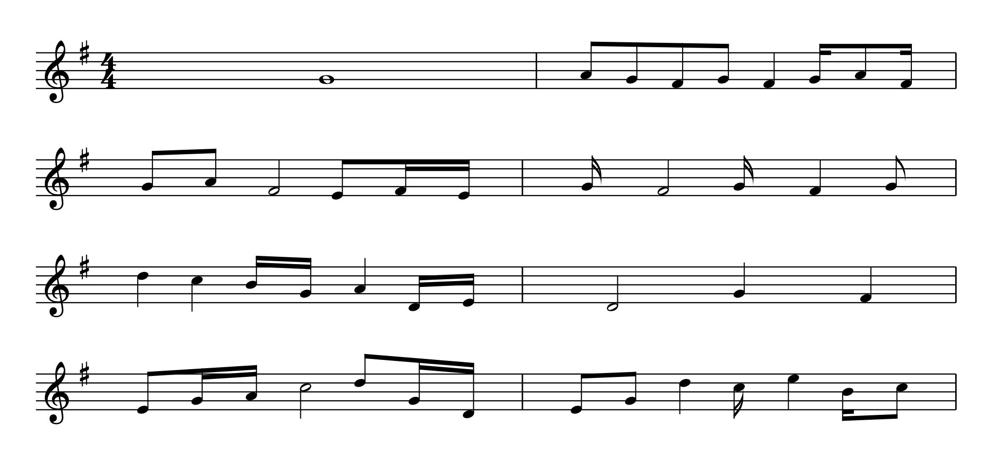

# Sight Reading Trainer

A Rust application for generating sight reading exercises for musicians.



## Quick Start

You need [Rust](https://www.rust-lang.org/tools/install) (2021 edition, so any recent version). From the project folder:

```bash
# 1. Preview an exercise in the terminal (4 measures in C major)
cargo run

# 2. Make sheet music: 8 measures in G major, saved as a PDF
cargo run -- -m 8 -k G --format pdf --output exercise.pdf

# 3. The same in bass clef, in F major
cargo run -- -m 8 -k F --clef bass --format pdf --output bass.pdf

# 4. Also save a MIDI file of the same exercise, with a count-in, to hear it
cargo run -- -m 8 -k G -f pdf --output exercise.pdf --midi exercise.mid -t 90 --count-in
```

Open the PDF in any viewer. Every run makes a new random exercise, so run it again for another one.
The key signature, clef and time signature are printed at the start of each line, and the notes
stay within the key.

See [Usage](#usage) and [Options](#options) for everything you can change: the number of measures,
the key, the clef, the range of notes, the note lengths and the size of the intervals.

## Features

- Generate random sight reading exercises with configurable parameters
- Multiple key signatures support
- Configurable octave range
- Various note durations (whole, half, quarter, eighth, sixteenth, dotted, triplets)
- Interval selection (steps, skips, leaps)
- ASCII art notation display
- PDF export
- MIDI export (piano, adjustable tempo, optional count-in)
- WAV export (rendered with a SoundFont you supply)
- Simple CLI interface

## Project Structure

The project is organized with a clean separation between domain logic and presentation:

```
src/
├── domain/          # Core music theory concepts
│   ├── mod.rs
│   ├── note.rs      # Note representation
│   ├── interval.rs  # Interval types and calculations
│   ├── key.rs       # Key signatures and modes
│   ├── time.rs      # Time signatures and beat divisions
│   ├── measure.rs   # Measure structure
│   └── clef.rs      # Treble and bass clef
├── generator/       # Exercise generation
│   ├── mod.rs       # Generator and configuration
│   ├── config.rs    # User configuration types
│   ├── melody.rs    # Picks pitches from the key's scale
│   ├── rules.rs     # Weights for moves through the scale
│   └── musical_phrase.rs
├── presentation/    # Display layer
│   ├── mod.rs
│   ├── ascii.rs     # ASCII art notation renderer
│   ├── pdf.rs       # PDF notation renderer
│   ├── midi.rs      # MIDI file writer
│   ├── beaming.rs   # Beam grouping and beam geometry
│   ├── spelling.rs  # Note spelling and accidentals
│   ├── music_glyphs.rs  # Generated clef, accidental and digit shapes (Bravura)
│   └── tui.rs       # TUI renderer (stub for future)
└── main.rs          # CLI entry point
```

## Usage

```bash
# Show help
cargo run -- --help

# Generate 8 measures in C major
cargo run -- -m 8 -k C

# Generate 16 measures in G major with 3 octaves
cargo run -- -m 16 -k G -o 3

# Generate with quarter note durations only
cargo run -- -m 8 -k C -d quarter

# Generate with only stepwise intervals
cargo run -- -m 8 -k C -i steps

# Generate and export to PDF
cargo run -- -m 8 -k G --format pdf --output exercise.pdf

# The same in bass clef
cargo run -- -m 8 -k F --clef bass --format pdf --output bass.pdf

# Export the PDF and a MIDI file of the same exercise, at 90 bpm with a one-measure count-in
cargo run -- -m 8 -k G -f pdf --output exercise.pdf --midi exercise.mid -t 90 --count-in
```

## Options

- `-m, --measures <COUNT>`: Number of measures to generate (default: 4)
- `-k, --key <KEY>`: Key (C, C#, D, D#, E, F, F#, G, G#, A, A#, B)
- `-c, --clef <CLEF>`: Clef, treble or bass (default: treble). The clef also sets the range of notes: C4 to B5 for treble and C2 to B3 for bass, with the default of 2 octaves.
- `-o, --octaves <COUNT>`: Number of octaves to cover, 1 to 10 (default: 2). A value that is not a whole number in that range is an error.
- `-d, --durations <TYPE>`: Duration types (simple, quarter, dotted, default: all)
- `-i, --intervals <TYPE>`: Interval types (steps, steps-skips, large, default: all)
- `-f, --format <FORMAT>`: Output format (ascii, pdf, default: ascii)
- `--output <FILE>`: Output file path (for PDF export, default: `exercise.pdf`). This option has no short form: `-o` is the octave count.
- `--midi <FILE>`: Also save the exercise as a MIDI file (acoustic grand piano). It works with any `--format` and uses the same notes as the PDF or ASCII output. No short form.
- `-t, --tempo <BPM>`: Speed of the MIDI file in quarter notes per minute, 20 to 300 (default: 80). Anything else is an error.
- `--wav <FILE>`: Also save the exercise as a WAV audio file, using the same notes, `--tempo` and `--count-in` as `--midi`. It needs a SoundFont. No short form.
- `--soundfont <FILE>`: The SoundFont (`.sf2`) for `--wav`. If omitted, the `SOUNDFONT` environment variable is used. No short form.
- `--count-in`: Start the MIDI/WAV file with one measure of metronome clicks (the first one accented).
- `-h, --help`: Show help message

## Listening to an exercise

QuickTime cannot open `.mid` files, but it plays `.wav` files, so `--wav` is the easy way to hear an exercise. It needs a SoundFont, a file of instrument sounds. We recommend [GeneralUser GS](https://schristiancollins.com/generaluser.php) (about 27 MB, free to use).

### Setting up GeneralUser GS

There is nothing to install. The SoundFont is a single `.sf2` file that the program reads.

1. Download GeneralUser GS and unzip it (double-click the zip in Finder). The folder inside holds a `.sf2` file, along with documentation and the license.
2. Move the `.sf2` file somewhere permanent. `~/Library/Audio/Sounds/Banks/` is the usual place on macOS, and GarageBand looks there too. Renaming it to `GeneralUser.sf2` saves quoting a name with spaces:

   ```bash
   mkdir -p ~/Library/Audio/Sounds/Banks
   mv ~/Downloads/<unzipped folder>/*.sf2 ~/Library/Audio/Sounds/Banks/GeneralUser.sf2
   ```

3. Optional: set the `SOUNDFONT` environment variable so you never need `--soundfont`. Use the full path, so it works from any folder:

   ```bash
   echo 'export SOUNDFONT="$HOME/Library/Audio/Sounds/Banks/GeneralUser.sf2"' >> ~/.zshrc
   source ~/.zshrc
   ```

### Making and playing a WAV

With `SOUNDFONT` set:

```bash
cargo run --release -- --wav ex.wav -t 90 --count-in
afplay ex.wav
```

Without it, pass the SoundFont each time:

```bash
cargo run --release -- --wav ex.wav --soundfont ~/Library/Audio/Sounds/Banks/GeneralUser.sf2 -t 90 --count-in
```

`--soundfont` takes priority over `SOUNDFONT` when both are given.

## Current Status

The initial version is functional with:
- Complete domain model for music theory concepts
- Guided random exercise generation: melodies move up and down through the notes of the key,
  prefer steps, and recover from leaps
- ASCII art notation display
- PDF export with treble or bass clef, key signature (sharps and flats), time signature, noteheads, stems,
  beams (grouped by the beat), flags, dots, ledger lines, accidentals and key-aware note spelling,
  laid out over several measures and pages
- MIDI export
- CLI interface

## Future Enhancements

- Improved ASCII notation with better visual representation
- Full treble/bass staff notation
- Support for grand staff (treble + bass clefs)
- PDF export (implemented)
- Interactive TUI with keyboard shortcuts
- Audio playback of generated exercises (MIDI files can be exported now)
- More MIDI instruments
- Web application frontend

## License

MIT

The clef, hollow notehead, sharp, flat, natural and time signature digit shapes used in the PDF output
(`src/presentation/music_glyphs.rs`) are derived from the
[Bravura](https://github.com/steinbergmedia/bravura) music font,
Copyright (c) 2015 Steinberg Media Technologies GmbH, licensed under the
SIL Open Font License 1.1 (see `LICENSES/Bravura-OFL.txt`).
